<picture>
  <source media="(prefers-color-scheme: dark)" srcset=".github/assets/banner-dark.svg">
  
</picture>

  
  
  

## About me

I'm **Stanley Coute**, also known by my Vietnamese name **Phước Lan**. I'm from Martinique, with Vietnamese roots,
and I build web applications from the front-end to the back-end.

I wrote my first line of code in Toulouse, France, in October 2025. Since then, I've been building apps
that are useful to the people around me.

## Where I'm headed

- **Done:** web developer internship at OPTIQUAL Lab (Sept–Oct 2026), my first team experience: pull requests
  to the staging branch, with Next.js, React, TypeScript and Symfony.
- **Now:** CS50 (Harvard, online), algorithms and programming fundamentals in C, Python and SQL.
- **Now:** the French professional title *Web and Mobile Web Developer* (DWWM, two years of higher education) at Studi,
  as a work-study program. **I'm looking for a host company in Toulouse, available now:
  4 days at work and 1 day of training per week.**
- **Next:** a bachelor's degree in software design and AI, then an engineering degree specialized in AI,
  to bring AI into companies' tools and information systems.

## Projects

| Project | About | Links |
| --- | --- | --- |
| **Expense Tracker** | Expense and payment tracking for CCR Toulouse, a church that used to manage everything in a spreadsheet. React 19 and TypeScript on the front-end; the back-end was rewritten from Symfony and API Platform to native PHP 8.5 MVC, with MySQL and Docker. | [Code](https://github.com/stanley-minh/Expense-Tracker) · [Case study (FR)](https://stanley-minh.github.io/portfolio/#/projets/expense-tracker) |
| **Portfolio "Rồng Mai"** | A metal dragon covered in lotus flowers, in red and gold. React 19, TypeScript and GSAP, deployed to GitHub Pages with GitHub Actions. | [Live site](https://stanley-minh.github.io/portfolio/) · [Code](https://github.com/stanley-minh/portfolio) |

## Stack

  
  
  
  
  
  
  
  
  
  
  
  
  

## Currently learning

  
  
  
  
  
  
  

Red and gold lotus: in my stack. Pink and sky-blue lotus, spinning the other way: currently learning.
